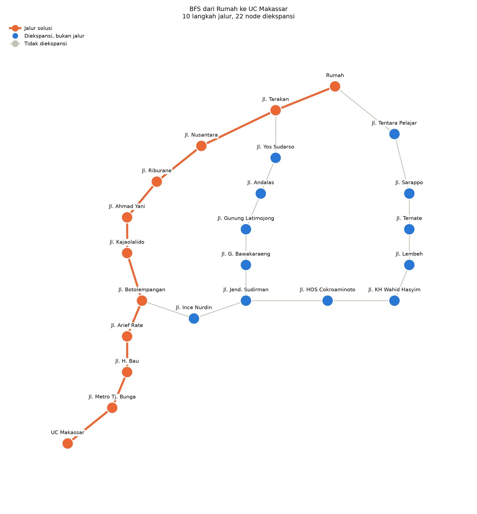
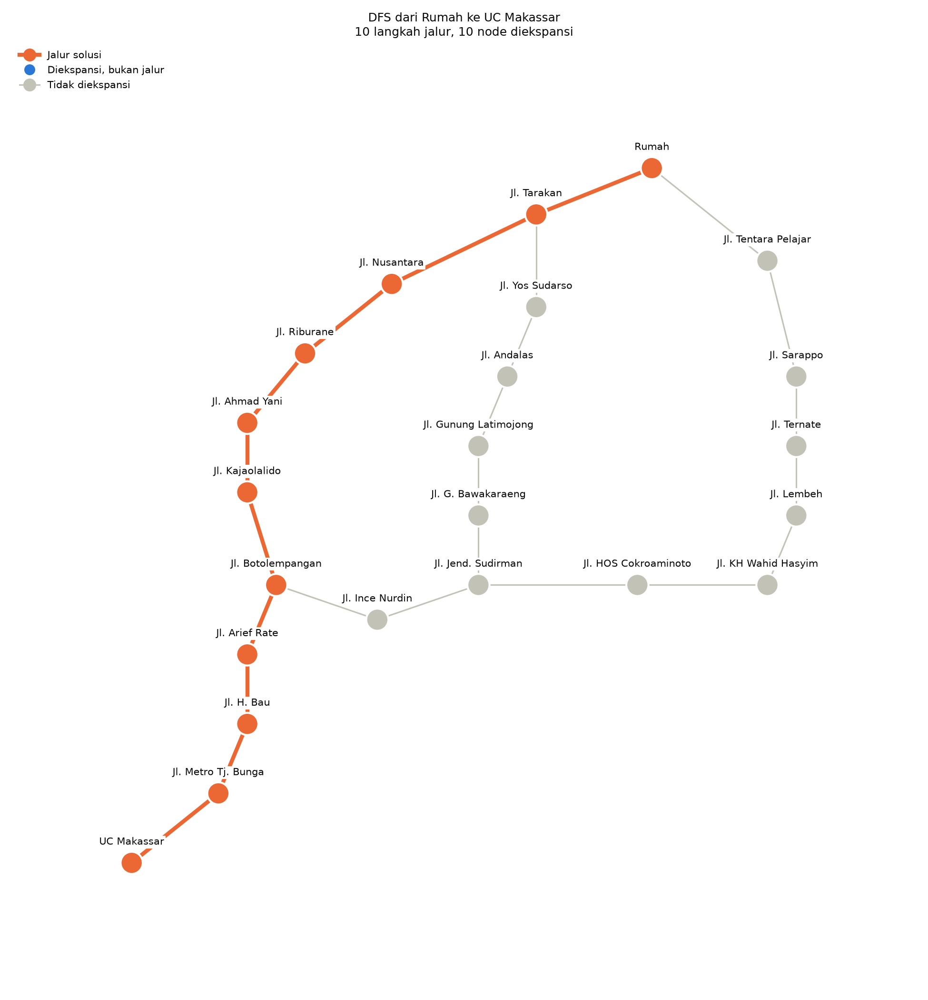

<div align="center">

<h1>GRAPH-SEARCH Rumah ke UC Makassar</h1>

<br/>

[![Python][badge-python]](https://www.python.org/)
[![Tooling][badge-uv]](https://github.com/astral-sh/uv)
[![Graph][badge-networkx]](https://networkx.org/)
[![Plot][badge-matplotlib]](https://matplotlib.org/)

<br/>

Mencari jalur dari **Rumah** ke **Kampus UC Makassar** (CitraLand City CPI) dengan algoritma **GRAPH-SEARCH tanpa bobot**, memakai dua strategi yaitu **BFS** dan **DFS**.

</div>

> [!NOTE]
> Inti algoritma di `core/search.py` hanya memakai standard library Python. NetworkX dan Matplotlib hanya dipakai oleh `core/visualize.py` untuk menggambar PNG.
>
> **Butuh Python 3.12 atau lebih baru.** Project ini dikelola dengan `uv`, tetapi Python biasa dengan `pip` juga bisa dipakai.

---

## Cara Menjalankan

Semua perintah dijalankan dari dalam folder `graph-search`. Ada dua cara, pilih salah satu.

<table width="100%">
<tr>
<td width="50%" valign="top">

### Dengan `uv` (Disarankan)

`uv` adalah package dan project manager Python yang sangat cepat, bisa dipakai di macOS, Linux, maupun Windows. Kalau belum terpasang, [lihat cara instalasinya di sini](https://docs.astral.sh/uv/getting-started/installation/).

`uv` otomatis membuat virtual environment dan memasang versi dependency yang sama persis dengan `uv.lock`, jadi tidak perlu mengaktifkan apa pun.

```bash
# 1. Pasang dependency
uv sync

# 2. Tabel trace di terminal
uv run main.py
uv run main.py --graph page08

# 3. Gambar PNG ke folder output/
uv run python -m core.visualize

# 4. Jalankan test
uv run python -m unittest -v
```

</td>
<td width="50%" valign="top">

### Python Biasa

Tanpa `uv`, cukup Python 3.12 atau lebih baru dan `pip`.

```bash
# 1. Buat virtual environment
python -m venv .venv

# 2. Aktifkan virtual environment
source .venv/bin/activate     # macOS / Linux
# .venv\Scripts\activate      # Windows

# 3. Pasang dependency (untuk gambar PNG)
pip install "networkx>=3.7" "matplotlib>=3.11.2"

# 4. Jalankan
python main.py
python main.py --graph page08
python -m core.visualize
python -m unittest -v
```

</td>
</tr>
</table>

> [!TIP]
> Langkah 3 di cara Python biasa hanya dibutuhkan untuk `core/visualize.py`. Tabel trace (`main.py`) dan test bisa langsung dijalankan tanpa memasang apa pun, karena hanya memakai standard library.

> [!NOTE]
> Di Windows, kalau perintah `python` tidak dikenali, pakai `py` sebagai gantinya (misalnya `py -m venv .venv`). Kalau memakai PowerShell, virtual environment diaktifkan dengan `.venv\Scripts\Activate.ps1`.

Hasil tiap perintah. Kalau memakai `uv`, awali perintahnya dengan `uv run`.

<table width="100%">
<thead>
<tr>
<th>Perintah</th>
<th>Hasil</th>
</tr>
</thead>
<tbody>
<tr><td><code>python main.py</code></td><td>Mencetak tabel trace BFS dan DFS per langkah untuk rute Rumah ke UC Makassar (node yang dikeluarkan, isi frontier, isi explored), lalu ringkasan path, jumlah langkah jalur, dan jumlah node yang diekspansi.</td></tr>
<tr><td><code>python main.py --graph page08</code></td><td>Sama seperti di atas, untuk graf validasi Page 08.</td></tr>
<tr><td><code>python -m core.visualize</code></td><td>Menggambar graf rute ke <code>output/bfs_route.png</code> dan <code>output/dfs_route.png</code>, dengan jalur hasil BFS dan DFS di-<i>highlight</i>.</td></tr>
<tr><td><code>python -m unittest -v</code></td><td>Menjalankan seluruh test di folder <code>tests/</code>.</td></tr>
</tbody>
</table>

---

## Data Graf

Graf rute disusun dari petunjuk arah Google Maps untuk tiga rute alternatif (lewat Jl. Nusantara, Jl. Andalas, dan Jl. Sarappo), dengan hasil **23 node dan 24 edge**.

<details>
<summary>Detail penyusunan graf</summary>

Setiap jalan menjadi satu node, dan dua jalan dihubungkan dengan edge kalau di petunjuk arah ada belokan atau lanjutan dari jalan yang satu ke jalan yang lain. Bundaran dan belokan tanpa nama jalan tidak dijadikan node.

**Jl. Lae-Lae tidak dijadikan node.** Di petunjuk arah rute ketiga, jalan itu hanya disebut sebagai arah tujuan ("*Head toward Jl. Lae-Lae*"), lalu rute langsung belok ke Jl. Tentara Pelajar, jadi tidak pernah dilewati.

Selain graf rute, ada graf `PAGE08` dari soal Page 08 (Denpasar ke Padangbai) yang dipakai untuk validasi.

</details>

---

## Aturan GRAPH-SEARCH

Setiap iterasi berjalan dengan urutan berikut.

1. Kalau frontier kosong, berhenti karena tidak ada solusi.
2. Keluarkan satu node dari frontier.
3. Goal test dilakukan saat node dikeluarkan, bukan saat dimasukkan ke frontier.
4. Masukkan state node ke explored set.
5. Bangkitkan tetangga urut abjad. Tetangga yang state-nya sudah ada di frontier atau explored set tidak ditambahkan.

<details>
<summary>Detail implementasi</summary>

Perbedaan BFS dan DFS hanya ada di frontier.

- BFS memakai `QueueFrontier` (FIFO). Tetangga dimasukkan dalam urutan abjad normal.
- DFS memakai `StackFrontier` (LIFO). Tetangga dimasukkan dalam urutan abjad terbalik, supaya tetangga dengan abjad terkecil berada di puncak stack dan diekspansi lebih dulu.

Urutan memasukkan tetangga diatur lewat atribut kelas `add_children_in_reverse_order` (`True` di `StackFrontier`, `False` di `QueueFrontier`), jadi `graph_search` tidak perlu mengecek jenis frontier.

**Kaitan dengan penanda di `core/search.py`.** Nomor langkah di atas sama dengan penanda `# Langkah 1 GRAPH-SEARCH` sampai `# Langkah 5 GRAPH-SEARCH` di `core/search.py`. Langkah 1 ditulis sebagai `while not frontier.empty()`, artinya pencarian terus berjalan selama frontier belum kosong, dan kalau frontier habis tanpa menemukan goal, hasilnya gagal (path bernilai `None`).

Pencetakan tabel trace dipisah dari algoritma. Selama pencarian, setiap langkah hanya dicatat, lalu tabelnya dicetak sekali setelah pencarian selesai kalau `trace=True`.

Fungsi `graph_search` menerima parameter tambahan `graph` dibanding yang tertulis di soal (`graph_search(start, goal, frontier)`), supaya fungsi yang sama bisa dipakai untuk graf rute dan graf Page 08 tanpa diubah.

</details>

---

## Hasil Rute Rumah ke UC Makassar

<table width="100%">
<tr>
<th></th>
<th>BFS</th>
<th>DFS</th>
</tr>
<tr>
<td><b>Jalur</b></td>
<td>Rumah, Jl. Tarakan, Jl. Nusantara, Jl. Riburane, Jl. Ahmad Yani, Jl. Kajaolalido, Jl. Botolempangan, Jl. Arief Rate, Jl. H. Bau, Jl. Metro Tj. Bunga, UC Makassar</td>
<td>Sama dengan BFS</td>
</tr>
<tr>
<td><b>Langkah jalur</b></td>
<td>10</td>
<td>10</td>
</tr>
<tr>
<td><b>Node diekspansi</b></td>
<td>22</td>
<td>10</td>
</tr>
</table>

<table width="100%">
<tr>
<th width="50%">BFS</th>
<th width="50%">DFS</th>
</tr>
<tr>
<td></td>
<td></td>
</tr>
</table>

<details>
<summary>Urutan ekspansi dan pembahasan BFS vs DFS</summary>

<table width="100%">
<tr>
<th></th>
<th>BFS</th>
<th>DFS</th>
</tr>
<tr>
<td><b>Urutan ekspansi</b></td>
<td>Rumah, Jl. Tarakan, Jl. Tentara Pelajar, Jl. Nusantara, Jl. Yos Sudarso, Jl. Sarappo, Jl. Riburane, Jl. Andalas, Jl. Ternate, Jl. Ahmad Yani, Jl. Gunung Latimojong, Jl. Lembeh, Jl. Kajaolalido, Jl. G. Bawakaraeng, Jl. KH Wahid Hasyim, Jl. Botolempangan, Jl. Jend. Sudirman, Jl. HOS Cokroaminoto, Jl. Arief Rate, Jl. Ince Nurdin, Jl. H. Bau, Jl. Metro Tj. Bunga</td>
<td>Rumah, Jl. Tarakan, Jl. Nusantara, Jl. Riburane, Jl. Ahmad Yani, Jl. Kajaolalido, Jl. Botolempangan, Jl. Arief Rate, Jl. H. Bau, Jl. Metro Tj. Bunga</td>
</tr>
</table>

BFS dan DFS sama-sama mendapat rute lewat Jl. Nusantara (10 langkah), yaitu rute yang juga paling cepat menurut Google Maps. Bedanya ada di jumlah node yang diekspansi. BFS mengekspansi 22 node, yaitu semua node selain goal, sedangkan DFS hanya 10 node.

BFS menelusuri graf lapis demi lapis, sehingga jalur pertama yang sampai ke goal **dijamin** punya jumlah langkah paling sedikit. Harga jaminan itu adalah BFS harus memeriksa node lapis demi lapis sampai lapis tempat goal berada, di sini hampir seluruh graf.

DFS langsung masuk sedalam mungkin ke tetangga dengan abjad terkecil. Dari Rumah, Jl. Tarakan lebih dulu dari Jl. Tentara Pelajar di urutan abjad, lalu dari Jl. Tarakan, Jl. Nusantara lebih dulu dari Jl. Yos Sudarso. Kebetulan jalan-jalan yang dipilih itu adalah rute dengan langkah paling sedikit, jadi DFS mendapat hasil yang sama dengan BFS, tetapi ekspansinya jauh lebih sedikit. Hasil ini **tidak dijamin**. Kalau urutan abjadnya berbeda, misalnya jalan pertama di sisi rute Jl. Sarappo abjadnya lebih kecil dari Jl. Tarakan, DFS akan masuk lewat sana lebih dulu dan mendapat jalur yang lebih panjang.

Graf Page 08 (Denpasar ke Padangbai) dipakai untuk validasi. BFS dan DFS sama-sama menghasilkan jalur Denpasar, Mengwi, Ubud, Padangbai, sesuai dengan pengerjaan manual. Polanya sama dengan rute Rumah ke UC Makassar, yaitu jalurnya sama tetapi DFS mengekspansi lebih sedikit node (4 dibanding 6).

</details>

---

## Pertanyaan Analisis

<details>
<summary>Lihat jawaban</summary>

**Mengapa explored set diimplementasikan dengan set, bukan list?**

1. **Pengecekan keanggotaan lebih cepat.** Perintah `neighbor in explored_set` pada set rata-rata O(1) karena set berbasis hash table. Pada list, operasi yang sama O(n) karena elemen harus dicek satu per satu dari depan.
2. **Pengecekan ini sering terjadi.** Setiap node anak yang dibangkitkan harus dicek apakah sudah ada di explored set. Kalau memakai list, waktu setiap pengecekan bertambah seiring banyaknya node yang sudah diekspansi, sehingga pencarian makin lambat ketika graf membesar.
3. **Set otomatis mencegah duplikat.** Satu state tidak mungkin tercatat dua kali di explored set.
4. **Urutan tidak dibutuhkan untuk pengecekan.** Explored set hanya perlu menjawab "sudah pernah diekspansi atau belum". Urutan ekspansi tetap dicatat di list terpisah (`explored_order`) hanya untuk keperluan output dan trace.

**Catatan.** `contains_state` pada frontier masih O(n) karena frontier disimpan sebagai list dan dicek satu per satu. Untuk graf kecil seperti tugas ini hal tersebut tidak masalah. Kalau grafnya besar, frontier bisa dilengkapi set tambahan berisi state-nya supaya pengecekannya juga O(1).

</details>

---

## Jarak km Dibanding Jumlah Langkah

<details>
<summary>Lihat perbandingan</summary>

<table width="100%">
<tr>
<th>Rute</th>
<th>Jarak (Google Maps)</th>
<th>Waktu (Google Maps)</th>
<th>Jumlah langkah di graf</th>
</tr>
<tr>
<td>Lewat Jl. Nusantara</td>
<td>6,6 km</td>
<td>18 menit</td>
<td>10</td>
</tr>
<tr>
<td>Lewat Jl. Andalas</td>
<td>6,6 km</td>
<td>19 menit</td>
<td>12</td>
</tr>
<tr>
<td>Lewat Jl. Sarappo</td>
<td>6,2 km</td>
<td>20 menit</td>
<td>13</td>
</tr>
</table>

Rute lewat Jl. Sarappo paling pendek dalam km, tetapi BFS tidak memilihnya. Alasannya, BFS pada graf tanpa bobot menghitung jumlah langkah (jumlah edge), dan setiap langkah dianggap bernilai 1 tidak peduli panjang jalannya. BFS memang optimal, tetapi optimal dalam jumlah langkah, dan itu hanya sama dengan jarak terpendek kalau semua langkah sama panjang.

Di rute ini panjang jalan sangat berbeda. Rute lewat Jl. Sarappo melewati banyak jalan pendek, misalnya Jl. Ternate 180 m, Jl. Lembeh 130 m, dan Jl. KH Wahid Hasyim 99 m, sehingga jumlah langkahnya paling banyak (13) walaupun jaraknya paling pendek. Sebaliknya, Jl. Nusantara sepanjang 1,5 km hanya dihitung satu langkah. Rute lewat Jl. Nusantara juga yang paling cepat (18 menit), tetapi itu kebetulan dan bukan karena BFS memperhitungkan waktu.

**Jarak tidak dipakai di algoritma.** Soal meminta graf tanpa bobot, jadi hasil yang benar memang jalur dengan langkah paling sedikit. Jarak dan waktu dari Google Maps hanya dipakai sebagai pembanding di sini dan tidak dipakai di algoritma.

Untuk mencari rute terpendek dalam km, setiap edge perlu diberi bobot jarak dan algoritmanya diganti, misalnya Uniform Cost Search. Selain itu, di graf ini jalan adalah node, sedangkan jarak di Google Maps adalah panjang jalan. Jadi jaraknya menempel di node, bukan di edge, dan graf perlu dimodelkan ulang dulu (persimpangan sebagai node, potongan jalan sebagai edge berbobot) sebelum bobot jarak bisa dipakai.

</details>

---

## Catatan Soal Goal dan Explored

<details>
<summary>Lihat catatan</summary>

**Goal tidak masuk explored secara default.** Alasannya, pada algoritma GRAPH-SEARCH, fungsi langsung mengembalikan solusi begitu goal test berhasil, sebelum node masuk ke explored set. Perilaku ini bisa diubah lewat parameter `include_goal_in_explored=True`, sehingga goal ikut dicatat di akhir urutan ekspansi.

</details>

[badge-python]: https://img.shields.io/badge/Python-3.12%2B-blue?style=flat&logo=data:image/svg%2Bxml;base64,PHN2ZyB4bWxucz0iaHR0cDovL3d3dy53My5vcmcvMjAwMC9zdmciIHZpZXdCb3g9IjAgMCAxMjggMTI4Ij48bGluZWFyR3JhZGllbnQgaWQ9InB5dGhvbi1vcmlnaW5hbC1hIiBncmFkaWVudFVuaXRzPSJ1c2VyU3BhY2VPblVzZSIgeDE9IjcwLjI1MiIgeTE9IjEyMzcuNDc2IiB4Mj0iMTcwLjY1OSIgeTI9IjExNTEuMDg5IiBncmFkaWVudFRyYW5zZm9ybT0ibWF0cml4KC41NjMgMCAwIC0uNTY4IC0yOS4yMTUgNzA3LjgxNykiPjxzdG9wIG9mZnNldD0iMCIgc3RvcC1jb2xvcj0iIzVBOUZENCIvPjxzdG9wIG9mZnNldD0iMSIgc3RvcC1jb2xvcj0iIzMwNjk5OCIvPjwvbGluZWFyR3JhZGllbnQ+PGxpbmVhckdyYWRpZW50IGlkPSJweXRob24tb3JpZ2luYWwtYiIgZ3JhZGllbnRVbml0cz0idXNlclNwYWNlT25Vc2UiIHgxPSIyMDkuNDc0IiB5MT0iMTA5OC44MTEiIHgyPSIxNzMuNjIiIHkyPSIxMTQ5LjUzNyIgZ3JhZGllbnRUcmFuc2Zvcm09Im1hdHJpeCguNTYzIDAgMCAtLjU2OCAtMjkuMjE1IDcwNy44MTcpIj48c3RvcCBvZmZzZXQ9IjAiIHN0b3AtY29sb3I9IiNGRkQ0M0IiLz48c3RvcCBvZmZzZXQ9IjEiIHN0b3AtY29sb3I9IiNGRkU4NzMiLz48L2xpbmVhckdyYWRpZW50PjxwYXRoIGZpbGw9InVybCgjcHl0aG9uLW9yaWdpbmFsLWEpIiBkPSJNNjMuMzkxIDEuOTg4Yy00LjIyMi4wMi04LjI1Mi4zNzktMTEuOCAxLjAwNy0xMC40NSAxLjg0Ni0xMi4zNDYgNS43MS0xMi4zNDYgMTIuODM3djkuNDExaDI0LjY5M3YzLjEzN0gyOS45NzdjLTcuMTc2IDAtMTMuNDYgNC4zMTMtMTUuNDI2IDEyLjUyMS0yLjI2OCA5LjQwNS0yLjM2OCAxNS4yNzUgMCAyNS4wOTYgMS43NTUgNy4zMTEgNS45NDcgMTIuNTE5IDEzLjEyNCAxMi41MTloOC40OTFWNjcuMjM0YzAtOC4xNTEgNy4wNTEtMTUuMzQgMTUuNDI2LTE1LjM0aDI0LjY2NWM2Ljg2NiAwIDEyLjM0Ni01LjY1NCAxMi4zNDYtMTIuNTQ4VjE1LjgzM2MwLTYuNjkzLTUuNjQ2LTExLjcyLTEyLjM0Ni0xMi44MzctNC4yNDQtLjcwNi04LjY0NS0xLjAyNy0xMi44NjYtMS4wMDh6TTUwLjAzNyA5LjU1N2MyLjU1IDAgNC42MzQgMi4xMTcgNC42MzQgNC43MjEgMCAyLjU5My0yLjA4MyA0LjY5LTQuNjM0IDQuNjktMi41NiAwLTQuNjMzLTIuMDk3LTQuNjMzLTQuNjktLjAwMS0yLjYwNCAyLjA3My00LjcyMSA0LjYzMy00LjcyMXoiIHRyYW5zZm9ybT0idHJhbnNsYXRlKDAgMTAuMjYpIi8+PHBhdGggZmlsbD0idXJsKCNweXRob24tb3JpZ2luYWwtYikiIGQ9Ik05MS42ODIgMjguMzh2MTAuOTY2YzAgOC41LTcuMjA4IDE1LjY1NS0xNS40MjYgMTUuNjU1SDUxLjU5MWMtNi43NTYgMC0xMi4zNDYgNS43ODMtMTIuMzQ2IDEyLjU0OXYyMy41MTVjMCA2LjY5MSA1LjgxOCAxMC42MjggMTIuMzQ2IDEyLjU0NyA3LjgxNiAyLjI5NyAxNS4zMTIgMi43MTMgMjQuNjY1IDAgNi4yMTYtMS44MDEgMTIuMzQ2LTUuNDIzIDEyLjM0Ni0xMi41NDd2LTkuNDEySDYzLjkzOHYtMy4xMzhoMzcuMDEyYzcuMTc2IDAgOS44NTItNS4wMDUgMTIuMzQ4LTEyLjUxOSAyLjU3OC03LjczNSAyLjQ2Ny0xNS4xNzQgMC0yNS4wOTYtMS43NzQtNy4xNDUtNS4xNjEtMTIuNTIxLTEyLjM0OC0xMi41MjFoLTkuMjY4ek03Ny44MDkgODcuOTI3YzIuNTYxIDAgNC42MzQgMi4wOTcgNC42MzQgNC42OTIgMCAyLjYwMi0yLjA3NCA0LjcxOS00LjYzNCA0LjcxOS0yLjU1IDAtNC42MzMtMi4xMTctNC42MzMtNC43MTkgMC0yLjU5NSAyLjA4My00LjY5MiA0LjYzMy00LjY5MnoiIHRyYW5zZm9ybT0idHJhbnNsYXRlKDAgMTAuMjYpIi8+PHJhZGlhbEdyYWRpZW50IGlkPSJweXRob24tb3JpZ2luYWwtYyIgY3g9IjE4MjUuNjc4IiBjeT0iNDQ0LjQ1IiByPSIyNi43NDMiIGdyYWRpZW50VHJhbnNmb3JtPSJtYXRyaXgoMCAtLjI0IC0xLjA1NSAwIDUzMi45NzkgNTU3LjU3NikiIGdyYWRpZW50VW5pdHM9InVzZXJTcGFjZU9uVXNlIj48c3RvcCBvZmZzZXQ9IjAiIHN0b3AtY29sb3I9IiNCOEI4QjgiIHN0b3Atb3BhY2l0eT0iLjQ5OCIvPjxzdG9wIG9mZnNldD0iMSIgc3RvcC1jb2xvcj0iIzdGN0Y3RiIgc3RvcC1vcGFjaXR5PSIwIi8+PC9yYWRpYWxHcmFkaWVudD48cGF0aCBvcGFjaXR5PSIuNDQ0IiBmaWxsPSJ1cmwoI3B5dGhvbi1vcmlnaW5hbC1jKSIgZD0iTTk3LjMwOSAxMTkuNTk3YzAgMy41NDMtMTQuODE2IDYuNDE2LTMzLjA5MSA2LjQxNi0xOC4yNzYgMC0zMy4wOTItMi44NzMtMzMuMDkyLTYuNDE2IDAtMy41NDQgMTQuODE1LTYuNDE3IDMzLjA5Mi02LjQxNyAxOC4yNzUgMCAzMy4wOTEgMi44NzIgMzMuMDkxIDYuNDE3eiIvPjwvc3ZnPgo=
[badge-uv]: https://img.shields.io/badge/Tooling-uv-purple?style=flat&logo=data:image/svg%2Bxml;base64,PHN2ZyB3aWR0aD0iNDEiIGhlaWdodD0iNDEiIHZpZXdCb3g9IjAgMCA0MSA0MSIgZmlsbD0ibm9uZSIgeG1sbnM9Imh0dHA6Ly93d3cudzMub3JnLzIwMDAvc3ZnIj4KPHBhdGggZD0iTS01LjI4NjE5ZS0wNiAwLjE2ODYyOUwwLjA4NDMwOTggMjAuMTY4NUwwLjE1MTc2MiAzNi4xNjgzQzAuMTYxMDc1IDM4LjM3NzQgMS45NTk0NyA0MC4xNjA3IDQuMTY4NTkgNDAuMTUxNEwyMC4xNjg0IDQwLjA4NEwzMC4xNjg0IDQwLjA0MThMMzEuMTg1MiA0MC4wMzc1QzMzLjM4NzcgNDAuMDI4MiAzNS4xNjgzIDM4LjIwMjYgMzUuMTY4MyAzNlYzNkwzNy4wMDAzIDM2TDM3LjAwMDMgMzkuOTk5Mkw0MC4xNjgzIDM5Ljk5OTZMMzkuOTk5NiAtOS45NDY1M2UtMDdMMjEuNTk5OCAwLjA3NzU2ODlMMjEuNjc3NCAxNi4wMTg1TDIxLjY3NzQgMjUuOTk5OEwyMC4wNzc0IDI1Ljk5OThMMTguMzk5OCAyNS45OTk4TDE4LjQ3NzQgMTYuMDMyTDE4LjM5OTggMC4wOTEwNTkzTC01LjI4NjE5ZS0wNiAwLjE2ODYyOVoiIGZpbGw9IiNERTVGRTkiLz4KPC9zdmc+Cg==
[badge-networkx]: https://img.shields.io/badge/Graph-NetworkX-orange?style=flat&logo=data:image/svg%2Bxml;base64,PHN2ZyB4bWxucz0iaHR0cDovL3d3dy53My5vcmcvMjAwMC9zdmciIHdpZHRoPSI2NCIgaGVpZ2h0PSI2NCIgdmVyc2lvbj0iMS4xIiB2aWV3Qm94PSItNC44MyAtMi4yMiAxMDQuOTYgMTA0Ljk2Ij48ZGVmcyAvPjxnIHRyYW5zZm9ybT0idHJhbnNsYXRlKC01MS43Nzg0LC0zNzMuNDEwNykiPjxnIHRyYW5zZm9ybT0icm90YXRlKC0yMCwxMTM4LjI4ODYsMjA3LjcyNDQpIj48Y2lyY2xlIHN0eWxlPSJmaWxsOiNmZjdmMGU7c3Ryb2tlOm5vbmUiIGN4PSI5Ny42IiBjeT0iNDguNCIgcj0iMTQuNiIgLz48Y2lyY2xlIHN0eWxlPSJmaWxsOm5vbmU7c3Ryb2tlOiMyYzdmYjg7c3Ryb2tlLXdpZHRoOjYuNTUiIGN4PSI5Ny43IiBjeT0iNDguNiIgcj0iMjIuNiIgLz48Y2lyY2xlIHN0eWxlPSJmaWxsOm5vbmU7c3Ryb2tlOiMyYzdmYjg7c3Ryb2tlLXdpZHRoOjQuNjgiIGN4PSI5Ni42IiBjeT0iOTcuMSIgcj0iMTIuMiIgLz48Y2lyY2xlIHN0eWxlPSJmaWxsOm5vbmU7c3Ryb2tlOiMyYzdmYjg7c3Ryb2tlLXdpZHRoOjMuMzUiIGN4PSI1NC44IiBjeT0iNDguNiIgcj0iOC44IiAvPjxwYXRoIHN0eWxlPSJmaWxsOm5vbmU7c3Ryb2tlOiMyYzdmYjg7c3Ryb2tlLXdpZHRoOjUuMzciIGQ9Im0gNjMuMiw0OC42IGggMTAiIC8+PHBhdGggc3R5bGU9ImZpbGw6bm9uZTtzdHJva2U6IzJjN2ZiODtzdHJva2Utd2lkdGg6Ny40OSIgZD0iTSA5Ny43LDcxLjIgViA4NS4xIiAvPjxjaXJjbGUgdHJhbnNmb3JtPSJtYXRyaXgoLTAuOTI1LDAuMzgsMC4zOCwwLjkyNSwwLDApIiByPSI4LjgiIGN5PSI4MCIgY3g9Ii0xMTQuNiIgc3R5bGU9ImZpbGw6bm9uZTtzdHJva2U6IzJjN2ZiODtzdHJva2Utd2lkdGg6My4zNSIgLz48cGF0aCBkPSJtIDEyOC42LDMzLjctOS4yLDMuOCIgc3R5bGU9ImZpbGw6bm9uZTtzdHJva2U6IzJjN2ZiODtzdHJva2Utd2lkdGg6NS4zNyIgLz48ZyB0cmFuc2Zvcm09Im1hdHJpeCgwLjU3MjgsMC4zMzE1LDAuMzMxNSwtMC41NzI4LDI2LjM0NDIsMTAyLjQ2MDIpIj48Y2lyY2xlIHI9IjguNiIgY3k9IjYwLjgiIGN4PSI1MC44IiBzdHlsZT0iZmlsbDpub25lO3N0cm9rZTojMmM3ZmI4O3N0cm9rZS13aWR0aDozLjI5IiAvPjxwYXRoIGQ9Im0gNTksNjAuOCBoIDkuOCIgc3R5bGU9ImZpbGw6bm9uZTtzdHJva2U6IzJjN2ZiODtzdHJva2Utd2lkdGg6NS4yNiIgLz48L2c+PGcgdHJhbnNmb3JtPSJtYXRyaXgoLTAuMDAyMywwLjY2MTgsMC42NjE4LDAuMDAyMywxNC42OTYxLC02LjIwOSkiPjxjaXJjbGUgc3R5bGU9ImZpbGw6bm9uZTtzdHJva2U6IzJjN2ZiODtzdHJva2Utd2lkdGg6My4yOSIgY3g9IjUwLjgiIGN5PSI2MC44IiByPSI4LjYiIC8+PHBhdGggc3R5bGU9ImZpbGw6bm9uZTtzdHJva2U6IzJjN2ZiODtzdHJva2Utd2lkdGg6NS4yNiIgZD0ibSA1OSw2MC44IGggOS44IiAvPjwvZz48Y2lyY2xlIHRyYW5zZm9ybT0ibWF0cml4KC0wLjcwODcsLTAuNzA1NSwtMC43MDU1LDAuNzA4NywwLDApIiBzdHlsZT0iZmlsbDpub25lO3N0cm9rZTojMmM3ZmI4O3N0cm9rZS13aWR0aDoyLjE4IiBjeD0iLTE0MC43IiBjeT0iLTM1LjciIHI9IjUuNyIgLz48cGF0aCBzdHlsZT0iZmlsbDpub25lO3N0cm9rZTojMmM3ZmI4O3N0cm9rZS13aWR0aDozLjQ4IiBkPSJtIDEyMS4xLDcwLjEtNC42LC00LjYiIC8+PGNpcmNsZSByPSI3IiBjeT0iOTcuMSIgY3g9Ijk2LjYiIHN0eWxlPSJmaWxsOiNmZjdmMGU7c3Ryb2tlOm5vbmUiIC8+PGNpcmNsZSByPSI1LjEiIGN5PSI0OC42IiBjeD0iNTQuOCIgc3R5bGU9ImZpbGw6I2ZmN2YwZTtzdHJva2U6bm9uZSIgLz48Y2lyY2xlIHN0eWxlPSJmaWxsOiNmZjdmMGU7c3Ryb2tlOm5vbmUiIGN4PSIxMzYuNCIgY3k9IjMwLjUiIHI9IjUuMSIgLz48cGF0aCBkPSJNIDExOS44LDc4LjIgMTA3LjIsODkuMSIgc3R5bGU9ImZpbGw6bm9uZTtzdHJva2U6IzJjN2ZiODtzdHJva2Utd2lkdGg6My40OCIgLz48L2c+PC9nPjwvc3ZnPg==
[badge-matplotlib]: https://img.shields.io/badge/Plot-Matplotlib-11557C?style=flat&logo=data:image/svg%2Bxml;base64,PHN2ZyB4bWxucz0iaHR0cDovL3d3dy53My5vcmcvMjAwMC9zdmciIGhlaWdodD0iNjQiIHZlcnNpb249IjEuMSIgdmlld0JveD0iNDY5LjY1IDM3LjkxIDE1Mi43NiAxNTIuNzYiIHdpZHRoPSI2NCI+PGcgdHJhbnNmb3JtPSJtYXRyaXgoMC45NDgxLDAsMCwwLjk0ODEsMjguMzY0Niw1LjkzNzEpIiBzdHlsZT0ic3Ryb2tlLWxpbmVqb2luOnJvdW5kIj48Y2lyY2xlIHI9Ijc0LjYiIGN5PSIxMTQuMyIgY3g9IjU0NiIgc3R5bGU9ImZpbGw6I2ZmZmZmZjtzdHJva2U6I2ZmZmZmZjtzdHJva2Utd2lkdGg6NC44IiAvPjxnIHRyYW5zZm9ybT0ibWF0cml4KDIuMTAzMywwLDAsMi4xMDMzLDQzMS45MjgsMzAuNTExMykiIHN0eWxlPSJzdHJva2U6IzAwMDAwMDtzdHJva2Utd2lkdGg6MC40NjtzdHJva2UtbGluZWpvaW46cm91bmQiPjxwYXRoIHN0eWxlPSJvcGFjaXR5OjAuNTY7ZmlsbDojMDA0Y2ZmIiBkPSJNNTQsMzkuNiA2MS4xLDM3LjMgNjEuNSwzOS42IDU0LjEsMzkuNloiIC8+PHBhdGggc3R5bGU9Im9wYWNpdHk6MC41NjtmaWxsOiNjZWZmMjkiIGQ9Ik01NCwzOS42IDYxLjksMTguNiA2OCwyMi4xIDU0LjEsMzkuNFoiIC8+PHBhdGggc3R5bGU9Im9wYWNpdHk6MC41NjtmaWxsOiNmZjY4MDAiIGQ9Ik01NCwzOS42IDM0LjgsMTYuNiA0MC43LDEyLjggNDcuMywxMC40IDUzLjksMzkuM1oiIC8+PHBhdGggc3R5bGU9Im9wYWNpdHk6MC41NjtmaWxsOiNmZmM0MDAiIGQ9Ik01NCwzOS42IDI4LjIsNDQuMyAyOC4xLDM2LjEgMzAuNCwyOC4yIDUzLjgsMzkuNVoiIC8+PHBhdGggc3R5bGU9Im9wYWNpdHk6MC42O2ZpbGw6IzI5ZmZjZSIgZD0iTTU0LDM5LjYgNDEuNyw0OC4xIDQwLjUsNDYuMSA1My45LDM5LjdaIiAvPjxwYXRoIHN0eWxlPSJvcGFjaXR5OjAuNTY7ZmlsbDojN2RmZjdhIiBkPSJNNTQsMzkuNiA1Ny4xLDU4IDQ5LjgsNTcuOCA1NCwzOS44WiIgLz48cGF0aCBzdHlsZT0ib3BhY2l0eTowLjU2O2ZpbGw6I2ZmNjgwMCIgZD0iTTU0LDM5LjYgNzcuNiw1OCA3Mi43LDYzIDU0LjIsMzkuOFoiIC8+PGNpcmNsZSBjeD0iNTQiIGN5PSIzOS42IiByPSIzMy43IiBzdHlsZT0iZmlsbDpub25lO3N0cm9rZTojMTE1NTdjO3N0cm9rZS13aWR0aDoxIiAvPjwvZz48L2c+PC9zdmc+

